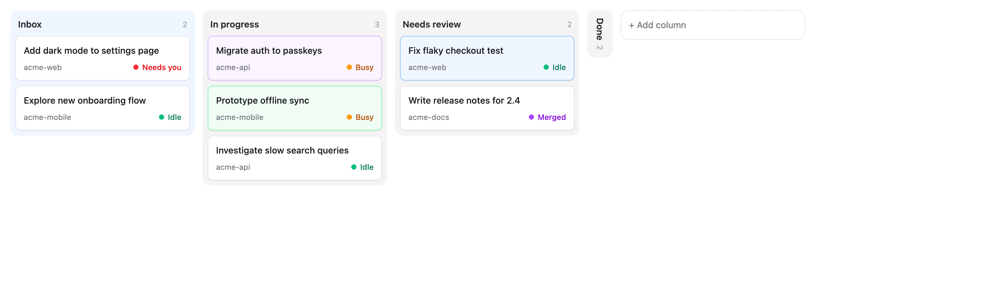
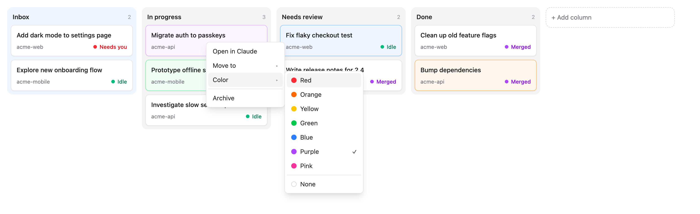
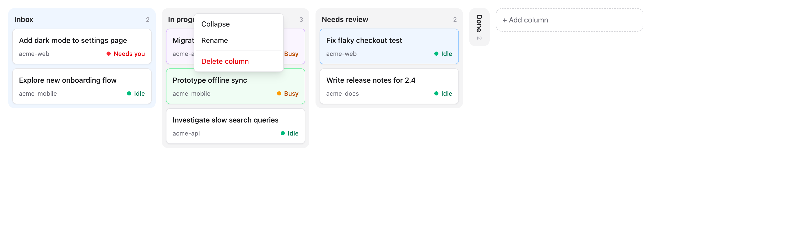
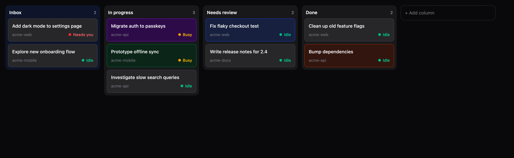

# Claudeboard

A kanban board for your [Claude desktop app](https://claude.ai/download) sessions.

Every running Claude Code session shows up as a card. You make the columns and drag the cards around however you like. Each card shows what its session is doing right now.



## What it does

- **Live sessions.** Reads `~/.claude/sessions` every 2 seconds. New sessions land in the **Inbox** (the blue column). It collapses on its own when it's empty.
- **Filter by project.** Select projects using chips, or a dropdown when there are more than five. Your selection is remembered between launches.
- **Live state.** Each card shows **Busy**, **Idle**, a red **Needs you** when Claude is asking you a question or waiting for permission, or a purple **Merged** once the session's pull request is merged.
- **Busy goes to the top.** A card that turns busy or starts needing you jumps to the top of its column. Otherwise your order stays.
- **Ended sessions hide.** When a session's process exits, its card disappears. If the session starts again, the card comes back in the same spot.
- **Your own columns.** Add, rename, reorder and delete columns. Deleting a column moves its cards back to the Inbox.
- **Collapse columns.** Right-click a column to collapse it into a thin vertical label. Click it to expand.
- **Right-click a card** to open it in Claude, give it a color, or archive it. Double-click also opens it.
- **Archive** only hides the card in Claudeboard. It doesn't touch the session in Claude.



Right-click a column to collapse, rename or delete it:



Dark mode follows your system:



## How it works

Claude has no official API for this. Claudeboard uses two undocumented things, so a Claude update could break it:

- Each running session writes `~/.claude/sessions/<pid>.json` with its title, folder, status and `hostSessionId`. Claudeboard keeps files whose process is still alive.
- Sessions started elsewhere (for example by a script) and then adopted by the Claude app show up too, even with no process left. Only ones from the last 24 hours land in the Inbox. Plain terminal sessions aren't adopted, so they stay off the board.
- Opening a card runs `open "claude://code/continue?session=local_…"`. If nothing happens, check that Claude's "entry points" setting is on.

The session files only say busy or idle. For **Needs you**, install the hooks once:

```bash
node scripts/install-hooks.mjs
```

This adds a few hooks to `~/.claude/settings.json` (a backup goes to `settings.json.before-claudeboard`). When Claude asks a question or wants permission, the hook creates `~/.claude/claudeboard/waiting/<session id>`. When you answer or the turn ends, it deletes it.

**Merged** comes from the Claude app's own record of each session, in `~/Library/Application Support/Claude/claude-code-sessions/`. It lists the session's pull requests and their state. A card shows Merged when it's idle, at least one PR is merged and none is still open.

Your board is saved to `~/Library/Application Support/net.rinik.claudeboard/board.json`.

## Running it

You need [Rust](https://rustup.rs), Node and [pnpm](https://pnpm.io). macOS only.

```bash
pnpm install
pnpm tauri dev
```

Retake the README screenshots (uses fake sessions from `docs/demo.html`, needs the dev server running):

```bash
scripts/screenshots.sh
```

Build an app bundle:

```bash
pnpm tauri build
```

## Stack

[Tauri 2](https://tauri.app), React, TypeScript, Tailwind CSS 4, [Base UI](https://base-ui.com) for menus, and [dnd-kit](https://dndkit.com) for drag and drop.
